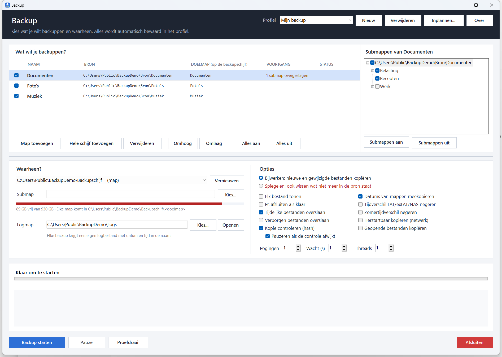
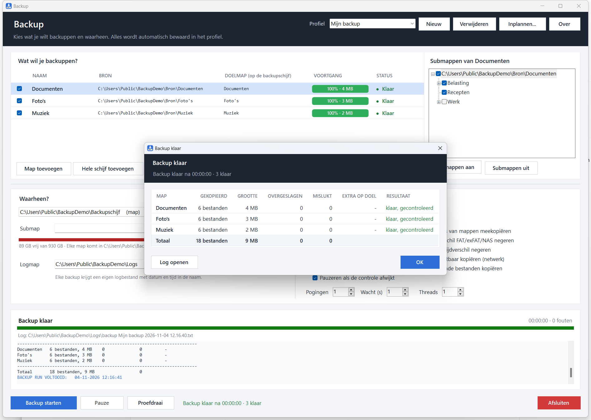

# Backup

Een Windows-programma om mappen en hele schijven naar een backupschijf te kopiëren. Met een eigen
kopieermotor (geen robocopy nodig), een overzichtelijk venster, controle van elke kopie met een hash en
automatisch inplannen via de Windows Taakplanner.



## Downloaden

Download `Backup.exe` bij de [nieuwste release](https://github.com/fvdijke/backup-tool/releases/latest)
(ook te vinden in [`App/`](App/Backup.exe)).

- Zet `Backup.exe` in een eigen map en start hem. Je instellingen komen in `backup-profielen.json` in
  dezelfde map.
- Vereist Windows 10 of 11 met de [.NET 9 Desktop Runtime](https://dotnet.microsoft.com/download/dotnet/9.0)
  (x64). Ontbreekt die, dan vraagt Windows bij het starten om hem te installeren.

## Wat het kan

**Bronnen en doel**
- Profielen: complete sets met bronnen, doel, logmap en opties. Alles wordt automatisch bewaard.
- Mappen toevoegen (meerdere tegelijk) of een hele schijf. Een schijf gaat 1-op-1 naar de hoofdmap van het
  doel, inclusief de losse bestanden in de root.
- Per bron submappen uitvinken in de mappenboom naast de lijst.
- Doel: een schijf (met vrije ruimte) of een map, met een submap naar keuze.

**Kopiëren**
- **Bijwerken**: nieuwe en gewijzigde bestanden kopiëren; niets wissen (zoals robocopy `/E /XO`).
- **Spiegelen**: het doel precies gelijk maken aan de bron, ook wissen wat niet meer in de bron staat
  (zoals robocopy `/MIR`). Uitgesloten bestanden en mappen worden nooit gewist.
- **Proefdraai**: laat zien wat er zou gebeuren, zonder iets te veranderen.
- **Pauze** en **stoppen** op elk moment, ook midden in een groot bestand.

**Opties**
- **Kopie controleren (hash)**: na elk gekopieerd bestand worden de SHA-256-hashes van origineel en kopie
  vergeleken. Wijkt een kopie af, dan kan de backup automatisch op pauze gaan.
- **Geopende bestanden kopiëren** via een schaduwkopie (Volume Shadow Copy), bijvoorbeeld een open
  Outlook-.pst.
- Tijdelijke en verborgen bestanden overslaan, datums van mappen meekopiëren, tijdverschil FAT/exFAT/NAS en
  zomertijd negeren, herstartbaar kopiëren over het netwerk, pogingen bij fouten en meerdere threads.

**Overzicht en automatisch**
- Voortgang per bron met percentage, snelheid en resterende tijd.
- Na afloop een pop-up met de totalen per bron, en een logbestand per backup met datum en tijd in de naam.
- Icoon bij de klok met meldingen; minimaliseren laat de tool daar doorlopen.
- **Inplannen** per profiel (dagelijks of wekelijks) via de Windows Taakplanner; een gemiste keer wordt
  ingehaald.
- Knop **Over** met uitleg van alle onderdelen en opties.



## Zelf bouwen

Vereist de [.NET 9 SDK](https://dotnet.microsoft.com/download/dotnet/9.0).

```
cd BackupTool
dotnet publish -c Release -o ..\App
```

Dit geeft één `Backup.exe` van ongeveer 670 kB.

## De kopieermotor testen

`MotorTest` bouwt een bron- en doelmap met lastige gevallen (nieuwer, ouder, gewijzigde grootte,
alleen-lezen, verborgen, uitsluitingen, extra's op het doel, lege mappen) en draait robocopy en de eigen
motor naast elkaar: bijwerken en spiegelen, met 1 en 4 threads, twee rondes achter elkaar. Daarna vergelijkt
hij de uitkomst bestand voor bestand (grootte, datum, kenmerken en inhoud) en de tellingen.

```
cd MotorTest
dotnet run -c Release -- <werkmap>
```

## Opbouw

| Map | Inhoud |
|---|---|
| `App/Backup.exe` | de gebouwde tool |
| `BackupTool/` | de broncode (C#, .NET 9, Windows Forms) |
| `MotorTest/` | vergelijkt de kopieermotor met robocopy |
| `docs/` | schermafdrukken voor deze README |
